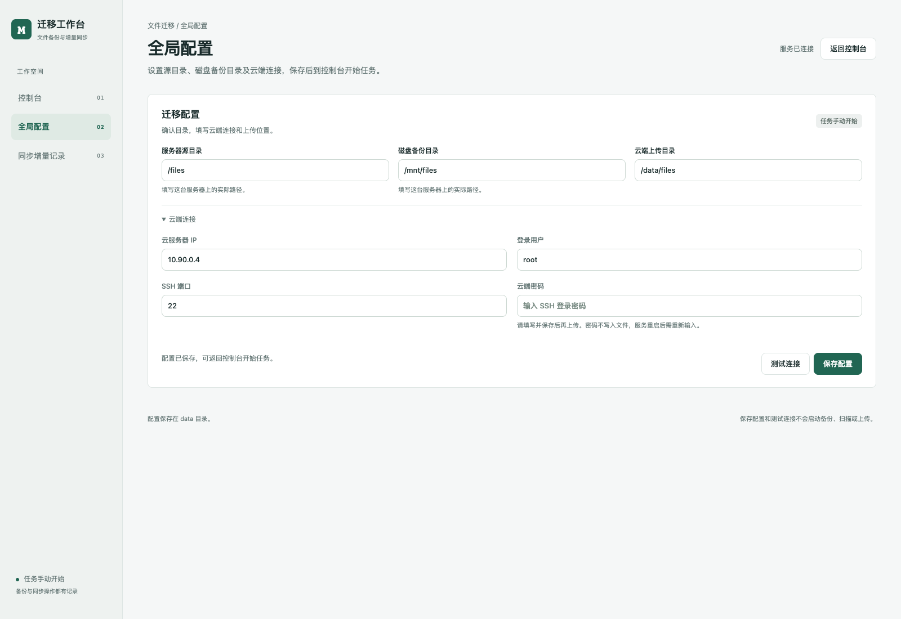
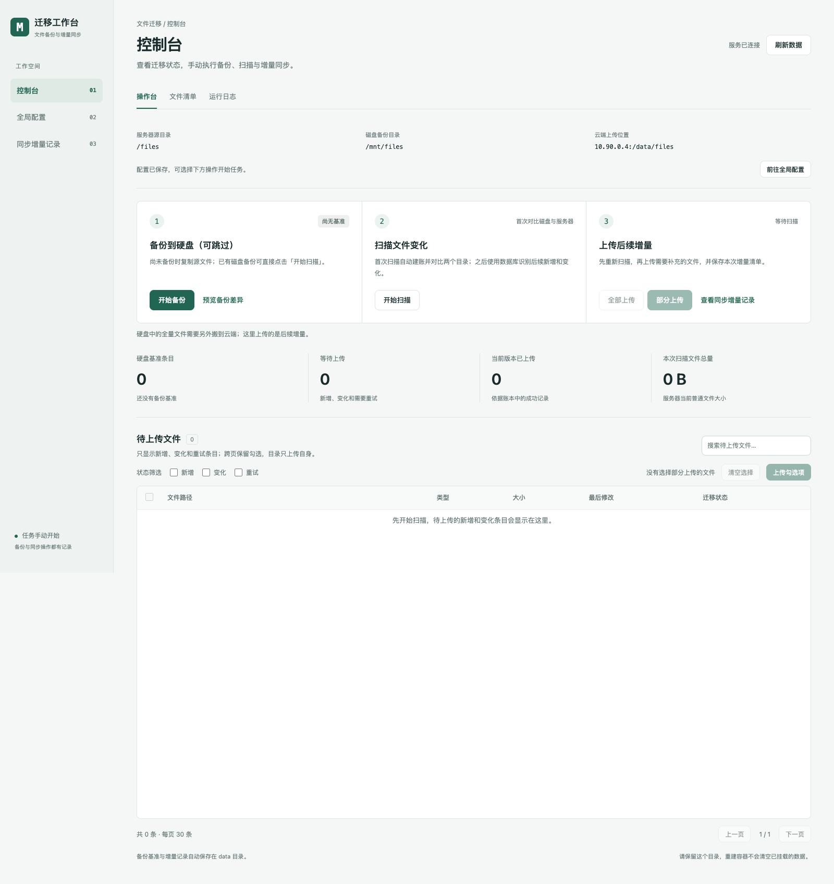
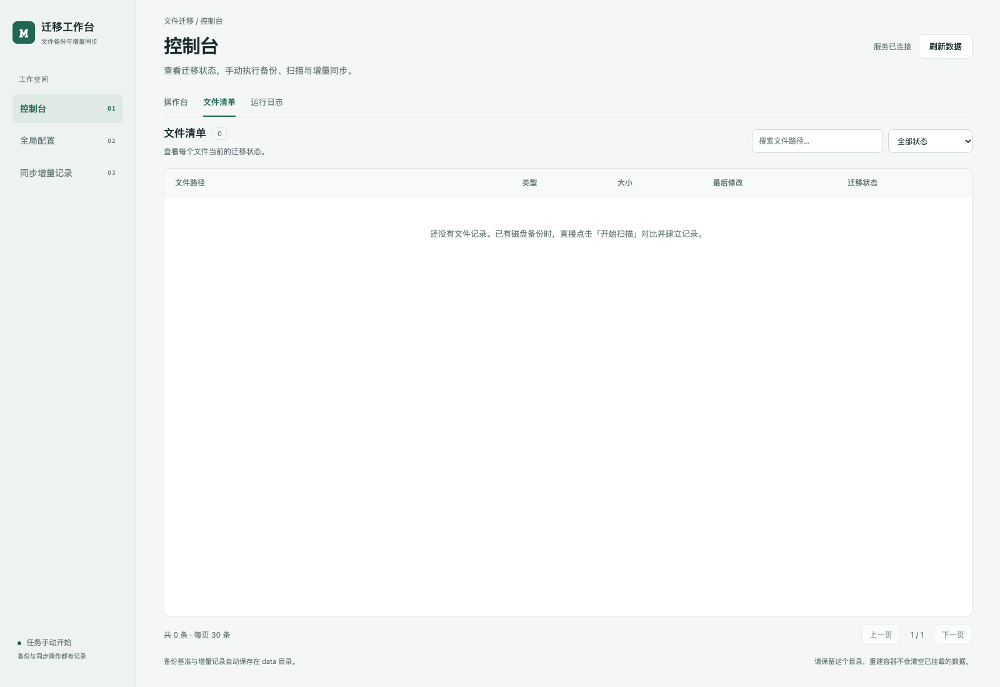
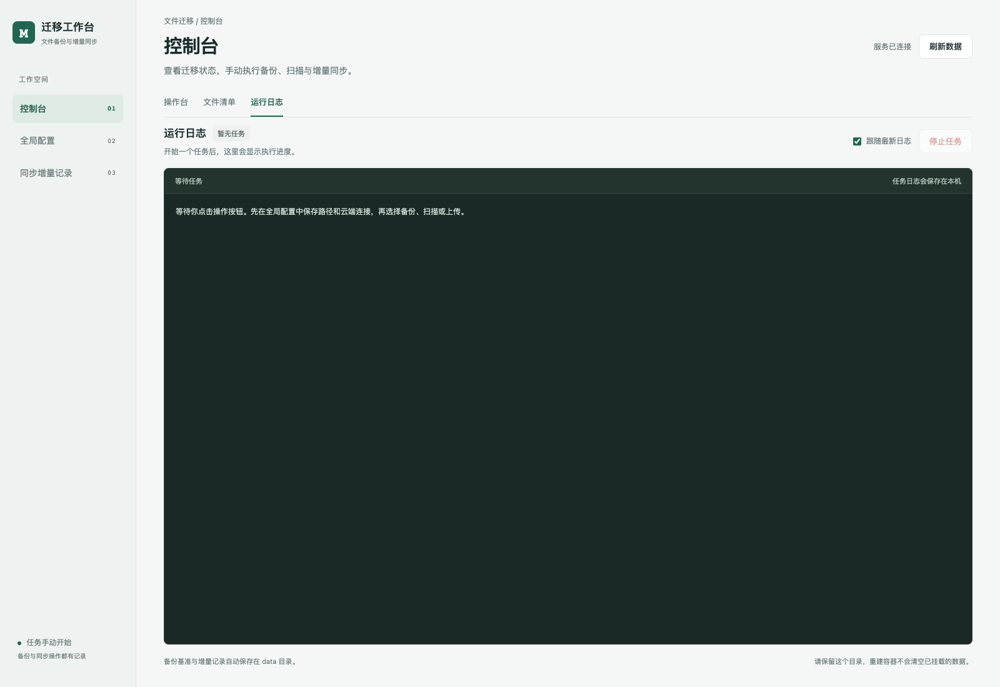
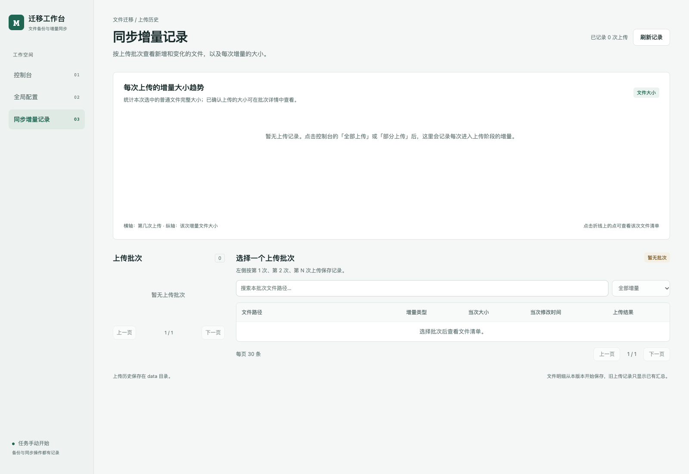
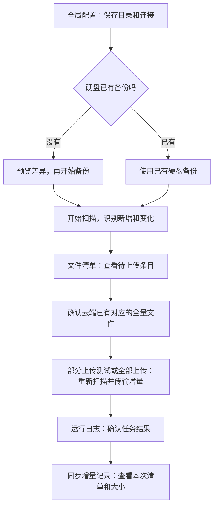

# ScanSyncBackup

通过页面完成硬盘备份、扫描文件变化和云端增量同步，并记录每次操作的结果。

- 安装、docker-compose、venv、独立脚本和 NFS 挂载：[option.md](option.md)。
- 备份基准、差异判断及上传原理：[datail.md](datail.md)。

本文介绍界面怎么用。截图使用示例配置，初始没有备份基准、文件记录和上传任务，显示 0 属于正常情况。

## 先了解三个菜单

| 菜单 | 用途 |
| --- | --- |
| 控制台 | 在「操作台」「文件清单」「运行日志」之间切换，执行任务并查看结果 |
| 全局配置 | 设置源目录、硬盘目录、云端上传目录和连接信息 |
| 同步增量记录 | 按第 1 次、第 2 次等上传批次查看文件明细及大小趋势 |

控制台每次只显示一个视图，切换时保留文件搜索、筛选和分页状态。操作台可以整页滚动；待上传表格高度为 640px，普通单行记录可同时展示 10 条以上，更多记录在表格内滚动。独立文件清单和日志仍在各自区域内滚动。

所有备份、扫描、上传都需要点击按钮并确认开始。打开页面和保存配置不会自动执行任务。

## 1. 先到全局配置保存路径和连接

图中上半部分设置文件位置，下半部分设置云端连接。三个目录的含义：

| 配置项 | 图中示例 | 意思 |
| --- | --- | --- |
| 服务器源目录 | `/files` | 需要备份、持续扫描的源文件目录 |
| 磁盘备份目录 | `/mnt/files` | 本机能访问的硬盘目录；使用 NFS 时填写本机挂载路径 |
| 云端上传目录 | `/data/files` | 文件最终上传到云服务器的目录 |

例如源文件 `/files/a.txt`，对应硬盘 `/mnt/files/a.txt`，上传后对应云端 `/data/files/a.txt`。

使用 Docker 时，Compose 已设置的源目录和硬盘目录只读显示；修改这两个目录需要修改 Compose 配置和挂载。

操作顺序：

1. 确认三个目录，填写云端 IP、用户、SSH 端口和密码。图中使用 `10.90.0.4`、`root`、`22`。
2. 点击「保存配置」。
3. 点击「测试连接」，确认云端 SSH 能正常连接。
4. 点击「返回控制台」，开始备份或扫描。

密码只在当前浏览器会话对应的服务内存中保留，刷新、切换页面后仍可使用；服务重启后重新输入，不写入配置或数据库。

右上角「服务已连接」表示页面能连接工作台，云端连接是否正常以「测试连接」结果为准。首次提示云端指纹未确认时，按 [option.md](option.md) 在容器内手动 SSH 登录一次。

## 2. 操作台：按三步完成备份和同步

图中间的三个区域是操作入口，下方四个数字显示当前备份和扫描情况。

### 第一步：备份到硬盘，可跳过

**还没有硬盘备份：**先点「预览备份差异」，确认目录和准备复制的文件，再点「开始备份」。成功后，文件保存在硬盘里，硬盘清单保存在数据库里，作为后续比较的基准。

**已经有硬盘备份：**直接进行第二步扫描。首次扫描会读取已有硬盘清单并建立基准，不需要重新复制文件。

使用 NFS 时，先确认备份目录已挂载好，再执行第一次备份或建立基准。安装和挂载步骤见 [option.md](option.md)。

### 第二步：扫描文件变化

点击「开始扫描」，确认后等待完成：

- 没有基准时，先读取已有硬盘备份，再对比源目录。
- 已有基准时，读取源目录，与数据库记录比较。
- 相同的记为已备份；新出现的记为新增；已有路径版本不同的记为变化。

扫描只读取文件并更新账本，不复制文件，也不上传。完成后，操作台下方的「待上传文件」显示新增、变化和需要重试的条目；「文件清单」标签仍展示完整记录。

### 第三步：先部分上传测试，再上传后续增量

**先确认云端已经放好与硬盘基准对应的全量文件。**「全部上传」只补充新增、变化和需要重试的条目，已标记为硬盘备份的文件会跳过；云端为空时，它不会自动把硬盘全量搬过去。

建议先选择少量文件测试：

1. 在操作台下方「待上传文件」搜索路径，并按新增、变化、重试筛选；状态可以多选，不选状态时展示全部待上传条目。
2. 勾选准备测试的条目，可以跨页选择。表头复选框只勾选当前页，筛选和翻页不会清空已选文件。
3. 查看「已选」数量和普通文件大小，再点击「部分上传」或列表旁的「上传勾选项」。确认框会列出选中的路径。
4. 程序重新扫描后，只上传勾选且仍需上传的条目，并记录本次结果。勾选目录只处理目录本身，不自动上传未勾选的子文件。

没有勾选文件时，「部分上传」按钮禁用，显示「没有选择部分上传的文件」。点击「清空选择」可取消全部勾选；上传任务结束后也会清空选择，防止复用旧清单。

测试通过后，可以点击「全部上传」并确认，处理所有待上传增量；全部上传不受勾选或筛选范围限制。任务开始后自动切换到「运行日志」，完成后可查看「同步增量记录」。

上传按钮尚未启用时，先保存全局配置并完成备份或首次扫描，建立硬盘基准。同一时间只执行一个任务，任务运行时其他操作按钮会暂时不可用。

### 下方四个数字怎么看

| 统计 | 意思 |
| --- | --- |
| 硬盘基准条目 | 数据库中保存的硬盘文件、目录和链接清单数量 |
| 等待上传 | 当前新增、变化及需要重试的条目数量 |
| 当前版本已上传 | 根据账本识别的已上传条目，不是云端全部文件数量 |
| 本次扫描文件总量 | 当前源目录普通文件大小的合计，表示文件总大小 |

「刷新数据」只更新页面展示，不会启动扫描。

## 3. 文件清单：确认哪些文件需要上传

图中右上方可以搜索路径、筛选状态，下方可以翻页；每页展示 30 条。初次使用没有记录时会显示空清单，完成备份或扫描后就能查看记录。

| 迁移状态 | 意思 |
| --- | --- |
| 硬盘已备份 | 当前版本与硬盘基准一致，无需增量上传 |
| 云端已上传 | 当前版本与上次成功上传的记录一致 |
| 新增待上传 | 新出现、尚未备份或成功上传的路径 |
| 变化待上传 | 已有路径的文件属性或版本发生变化 |
| 上传待重试 | 上次未确认成功，后续可以重新上传 |
| 源端已删除 | 源目录已经没有这个条目，只记录，不删除硬盘或云端旧文件 |
| 不支持的文件 | 特殊文件，需要单独处理 |

想看本次需要补充什么，可以筛选「新增待上传」「变化待上传」「上传待重试」。扫描会比较类型、大小、修改时间、权限、属主和链接目标，忽略扩展属性，不做完整文件内容哈希。

## 4. 运行日志：看进度和失败原因

图中左上方显示任务名称和状态，深色区域显示执行输出。没有开始任务时显示「暂无任务」；任务开始后会显示扫描数量、传输进度或具体错误。

- 勾选「跟随最新日志」，自动滚动到最新输出；阅读前面的日志时可以取消勾选。
- 「停止任务」只在任务运行中可用，停止后查看日志确认结果。
- 失败或中断后，保留账本，处理报错原因，再重新执行扫描或上传。

关闭浏览器页面不会停止正在执行的任务。需要停止时使用「停止任务」。

## 5. 同步增量记录：查看每次传了什么

第一次进入上传阶段后，这里开始保存批次记录。图中尚未上传，因此趋势图和批次列表为空。

上传后可以：

1. 在左侧选择第 1 次、第 2 次等上传批次。
2. 在右侧查看当次文件路径、增量类型、大小、修改时间、上传结果和错误。
3. 搜索当次文件，或筛选新增、变化、失败重试。
4. 点击折线图上的点，查看对应批次。

折线图统计当次选中普通文件的完整大小，不是实际网络传输流量。例如一个文件从 20 MB 改成 30 MB，本次统计是 30 MB。目录和符号链接不计大小；进入上传阶段但没有增量时，也会保存 0 B 批次。

同时看「增量文件总大小」与「已确认上传大小」：前者是计划传输的文件大小，后者是本次确认成功的大小，失败不算成功。

## 按这个顺序使用

日常使用时，源目录有新数据就扫描并上传；可以直接「全部上传」，它会先扫描一次；只测试少量文件时使用「部分上传」。保留项目的 `data` 目录，其中保存备份基准、上传历史和任务日志。
