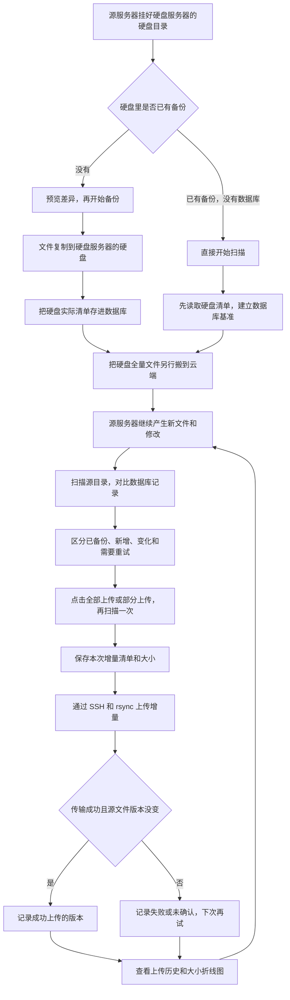

# 文件备份和增量同步详细说明

这份文档按当前 `scan_sync_backup.py` 的实际行为解释流程，使用源服务器 `10.90.0.2`、硬盘服务器 `10.90.0.3`、云服务器 `10.90.0.4` 作为示例地址。安装 NFS、配置容器的命令见 [option.md](option.md)。以下项目命令都在 `ScanSyncBackup` 根目录执行，项目可以放在任意位置。这里重点讲：文件从哪里来、备份到哪里、怎样发现变化、什么时候上传，以及失败后怎样继续。

## 一、先认清三台服务器

| 服务器 | 用来做什么 | 使用的目录 |
| --- | --- | --- |
| `10.90.0.2`，简称源服务器 | 存放源文件，运行工作台或脚本 | 源目录 `/files/file_server`；NFS 挂载目录 `/mnt/files` |
| `10.90.0.3`，简称硬盘服务器 | 存放硬盘备份，通过 NFS 给源服务器使用 | `/data/file_server` |
| `10.90.0.4`，简称云端 | 接收全量文件和后续增量 | `/files/file_server` |

硬盘服务器把 `/data/file_server` 共享给源服务器。源服务器挂到 `/mnt/files` 后，从这个路径看到的就是硬盘服务器硬盘上的文件。往 `/mnt/files` 写文件，也是在往硬盘服务器的硬盘写文件。

同一个文件的路径对应关系：

```text
源文件：     源服务器:/files/file_server/report/a.txt
硬盘备份：   硬盘服务器:/data/file_server/report/a.txt
源服务器看到的备份： /mnt/files/report/a.txt
云端文件：   10.90.0.4:/files/file_server/report/a.txt
账本记录：   report/a.txt
```

脚本用目录里面的相对路径对应文件。`report/a.txt` 是这一份文件的名字，不会因为服务器不同而变成三份记录。

## 二、整个流程图



已有数据库基准时，直接从“扫描源目录”开始。打开页面、保存配置不会执行这张图里的备份或上传，必须点击对应按钮。

## 三、第一次备份到硬盘

### 1. 先确认挂载

在源服务器上执行：

```bash
mountpoint /mnt/files
ls /mnt/files
```

确认 `/mnt/files` 已挂载，再操作备份。脚本只认目录，不会替你检查它是否真的是 NFS；如果挂载没成功就执行备份，可能把文件写到源服务器自己的磁盘上。

Docker 部署还要先把源目录配置成 `/files/file_server`，备份目录配置成 `/mnt/files`。页面只展示 Compose 已设置的路径。

### 2. 先预览，再复制

页面点击「预览备份差异」，只看哪些文件需要复制，不复制文件，也不改数据库基准。确认路径和结果后，点击「开始备份」。

不用页面时，在源服务器上执行：

```bash
python3 scan_sync_backup.py backup --source /files/file_server --disk /mnt/files --dry-run
python3 scan_sync_backup.py backup --source /files/file_server --disk /mnt/files
```

实际复制方向是：

```text
源服务器的 /files/file_server/ → 源服务器的 /mnt/files/ → 硬盘服务器的 /data/file_server/
```

脚本使用 rsync，复制目录里面的内容，并尽量保留权限、属主、硬链接、ACL 和扩展属性。已经相同的文件通常跳过，有差异的文件会更新。目标里额外存在的文件不会被删除。

这里的“全量备份”是让硬盘拥有源目录的文件，重复运行并不一定重新传输每个文件，也不会自动给你建立一份带日期的独立副本。

### 3. 复制成功后记录硬盘基准

rsync 成功后，脚本再读取硬盘实际存在的文件，把路径、大小、修改时间等保存到数据库。

这份记录就是“硬盘基准”：它记住硬盘里当时有什么，而不是保存文件正文。

数据库位置：

| 运行方式 | 数据库位置 |
| --- | --- |
| Docker 容器内 | `/app/data/backup_state.db` |
| 源服务器宿主机 | `data/backup_state.db` |
| 在项目根目录直接运行内置脚本，使用默认账本 | `data/backup_state.db` |

`data/settings.json` 中的 `db` 保存为 `backup_state.db`，以配置文件所在目录为基准，因此实际数据库仍是 `data/backup_state.db`。运行时自动解析成绝对路径，搬迁项目不再携带原机器的用户目录。

硬盘复制失败时，任务会报错，不会把失败的复制当成一次成功的新基准。硬盘可能已经收到部分文件，修复错误后可以再次执行备份。

rsync 正在复制时，源文件仍可能被业务修改。这不是某一时刻的文件快照；需要一份一致的初始数据时，应让相关业务暂停写入后完成备份。后续扫描可以发现变化，但不能保证一组关联文件在复制过程中始终一致。

## 四、已经备份过硬盘，但没有数据库

这种情况不用重新复制，直接点击「开始扫描」。

脚本发现没有基准后会做两件事：

1. 读取 `/mnt/files`，把已有硬盘文件清单保存成基准。
2. 读取 `/files/file_server`，与这份基准对比，标记相同、新增和变化。

对应命令：

```bash
python3 scan_sync_backup.py scan --source /files/file_server --disk /mnt/files
```

这一步只读源文件和硬盘文件，写入数据库，不会把源文件复制回硬盘，也不会上传云端。

首次建立基准必须能读到原备份。目录不存在或为空会报错。不要拿一个无关目录当硬盘备份，也不要直接把当前源目录当旧备份，否则对比没有意义。

基准建立成功后，后续扫描使用数据库中的记录，不必每次连接硬盘。硬盘后来被其他程序修改，数据库不会自动知道。

旧版本因扩展属性不同把文件判为变化时，升级后再执行一次扫描即可重新分类。已有硬盘基准和上传记录中的属性哈希会被忽略，不需要重新备份、删除数据库或重新读取硬盘。

## 五、先把硬盘全量文件搬到云端

这是流程中必须单独完成的一步。

“硬盘已备份”的文件会被增量上传跳过。即使云端是空目录，点击「全部上传」或「部分上传」也不会自动把所有硬盘文件补过去。

所以云端要先拥有与硬盘基准对应的全量文件。你可以把硬盘搬到云端机器后复制，也可以在源服务器上读取 NFS，通过 SSH 传过去。

下面是通过源服务器传输的方式。云端需要安装 rsync；命令使用 `root` 和 SSH 端口 `22`。在源服务器宿主机执行：

```bash
ssh -p 22 root@10.90.0.4
```

首次提示指纹时输入 `yes`，输入云端密码。登录后创建目录，再退出：

```bash
mkdir -p /files/file_server
exit
```

回到源服务器，先预览，再复制硬盘里的全量文件：

```bash
rsync -aHAXx --numeric-ids --dry-run --itemize-changes \
  -e 'ssh -p 22' /mnt/files/ root@10.90.0.4:/files/file_server/

rsync -aHAXx --numeric-ids --info=progress2 --partial-dir=.rsync-partial \
  -e 'ssh -p 22' /mnt/files/ root@10.90.0.4:/files/file_server/
```

目录末尾的 `/` 表示复制目录里面的内容。最终应是云端的 `/files/file_server/report/a.txt`，而不是多套一层目录。

等命令成功完成，再开始增量上传。这个手动全量传输不会创建工作台的增量上传批次；已有数据库里的硬盘基准继续用于对比。

全量搬运期间，保持硬盘备份内容不变。源服务器源目录产生的新文件或修改，可以等全量完成后再扫描并上传。

完成全量后，日常使用「开始扫描」「全部上传」或「部分上传」即可。再次「开始备份」会更新硬盘并重建基准；如果新基准对应的文件没有同步搬到云端，这些文件可能被标为已备份而跳过上传。

## 六、扫描怎样发现不同

### 1. 扫描每次都会遍历源目录

有基准后，扫描读取的是源服务器的 `/files/file_server`，对比数据库里的硬盘基准和上次成功上传的版本。

“增量”说的是筛选出来需要传输的文件；扫描本身仍然遍历整个源目录，不是只看最近几个新文件。

### 2. 如何判断同一个版本

普通文件主要比较：

- 相对路径和文件类型。
- 文件大小和修改时间，修改时间允许 1 秒以内的差异。
- 权限、属主、属组。

扩展属性不参与差异判断，包括 SELinux 标签、NFSv4 ACL 等，避免本地文件与 NFS 呈现方式不同导致误判。仅这些属性变化不会触发上传；rsync 实际传输时仍尽量保留 ACL 和扩展属性。

符号链接还比较它指向哪里；目录比较类型和权限等属性，目录修改时间本身不用于判断变化。

脚本没有逐个计算普通文件正文的完整哈希。如果正文变了，但大小、时间和其他被比较的属性都没有变化，可能无法识别。

扫描不跟随符号链接，也不继续进入源目录下的其他挂载点。

### 3. 扫描后的状态

| 状态 | 大白话解释 | 是否进入增量上传 |
| --- | --- | --- |
| `DISK_BACKED`，硬盘已备份 | 当前版本与硬盘基准相同 | 否，依赖已经搬到云端的全量文件 |
| `CLOUD_UPLOADED`，云端已上传 | 当前版本与上次成功上传的版本相同 | 否 |
| `NEW`，新增 | 这个路径没有硬盘基准，也没有成功上传记录 | 是 |
| `CHANGED`，变化 | 路径以前有记录，现在版本不同了 | 是 |
| `UPLOAD_FAILED`，等待重试 | 之前没有确认上传成功，当前仍需传输 | 是 |
| `SOURCE_DELETED`，源端删除 | 上次扫描见过，这次源目录里没有了 | 否，只记录，不删硬盘或云端文件 |
| `ERROR`，不支持上传 | 例如特殊设备文件，不能按普通文件上传 | 否，需要单独处理 |

状态按顺序判断：源端已删除 → 与硬盘基准相同 → 与成功上传版本相同 → 判断特殊文件、失败、变化或新增。一个条目可能已经有云端记录，但因为又与硬盘基准相同，页面显示为“硬盘已备份”。

### 4. 看一个具体例子

假设硬盘基准中有：

| 文件 | 硬盘版本 | 当前源目录版本 | 扫描结果 |
| --- | --- | --- | --- |
| `a.txt` | 10 MB | 没变化 | 硬盘已备份，不上传 |
| `b.log` | 20 MB | 改成 30 MB | 变化，上传当前版本 |
| `c.pdf` | 没有 | 新增 5 MB | 新增，上传 |
| `d.txt` | 2 MB | 源目录已删除 | 不上传、不删除硬盘或云端的旧文件 |

如果 `d.txt` 从未进入源目录扫描记录，脚本也不会凭硬盘里有它就创建一条“源端删除”记录；硬盘和云端的旧文件仍会保留。

本次普通文件增量大小是 `30 MB + 5 MB = 35 MB`。`b.log` 虽然只增加了 10 MB，历史图表仍按它当前完整的 30 MB 计算。

## 七、点击上传后发生什么

### 1. 先准备容器内的 SSH

使用 Docker 时，首次上传前在源服务器上执行：

```bash
docker-compose exec migration bash
ssh -p 22 root@10.90.0.4
```

输入 `yes` 确认云端指纹，再输入密码。登录成功后：

```bash
exit  # 从云端回到容器
exit  # 从容器回到源服务器
```

宿主机和容器的 SSH 指纹记录是两份。前面在宿主机手动搬全量时登录过，不代表容器已经确认过，容器内仍需操作一次。

容器指纹保存在挂载的 `ssh/known_hosts`。SSH 登录只保存指纹，不保存密码；页面仍要填写云端密码。

### 2. 保存页面配置并测试连接

页面填：

| 项目 | 值 |
| --- | --- |
| 源目录 | `/files/file_server` |
| 备份目录 | `/mnt/files` |
| 云端 IP | `10.90.0.4` |
| 云端路径 | `/files/file_server` |
| 用户 | `root` |
| SSH 端口 | `22` |
| 密码 | 云端登录密码 |

点击「测试连接」，只检查 SSH 连接和认证，不上传文件。成功后再「全部上传」或「部分上传」。

### 3. 全部上传与部分上传都会再扫描一次

即使刚点过「开始扫描」，「全部上传」或「部分上传」也会重新扫描，尽量把两次操作之间新增和修改的文件算进去。

扫描结束后，只选当前仍存在的新增、变化、需要重试的普通文件、目录和符号链接。「部分上传」还会按用户勾选的相对路径限制清单，不扩展目录子文件；空选择会报错，不会退回全部上传。部分上传仍保存正常上传批次，但明细和大小仅统计实际选中的候选。

### 4. 先记清单，再传文件

上传前，脚本把本次路径、类型、大小、修改时间和分类保存成独立的历史记录。之后文件再次修改，不会覆盖本次清单。

然后通过 SSH 创建或检查云端目录是否可写，再让 rsync 按清单传输：

```text
源服务器:/files/file_server/ → 10.90.0.4:/files/file_server/
```

增量文件直接从源服务器的源目录发送，不需要先写回硬盘服务器的硬盘。

### 5. 传完还要确认源版本

脚本要求 rsync 成功，并再次检查源文件的属性是否仍与上传前记录相同，才把这个版本记为上传成功。普通文件的这次检查要求大小和修改时间完全一致。

如果传输期间文件又变了，或文件消失了，就不能确认本次已经同步好，会留下错误供后续重试。这里仍是属性检查，不是下载云端文件再做内容哈希。

如果整次 rsync 返回非零退出码，本次候选条目都不会被确认为成功。云端可能已经收到一部分文件，但再次运行时会重新核对和传输。

## 八、第二次、第三次怎样同步

接着前面的例子：第一次上传成功后，账本记住 `b.log = 30 MB` 和 `c.pdf = 5 MB` 的上传版本。

| 操作 | 源文件变化 | 需要上传的文件 | 本次增量总大小 |
| --- | --- | --- | --- |
| 第 1 次 | `b.log` 变为 30 MB；新增 `c.pdf` 5 MB | `b.log`、`c.pdf` | 35 MB |
| 第 2 次 | `b.log` 又改成 32 MB；`c.pdf` 不变 | `b.log` | 32 MB |
| 第 3 次 | 所有源文件都没有再变化 | 无 | 0 MB |

第 2 次的 `b.log` 仍归为“变化”，不会因为它之前上传过就忽略，也不会再次算成首次新增。

进入上传阶段后，即使没有需要上传的文件，也会保存一条 0 B 的成功批次。扫描或连接检查在进入上传阶段之前失败，则不会产生本次上传批次。

页面「同步增量记录」按次展示每次清单、大小和结果。折线图展示的是每次选中普通文件的完整大小，不是实际网络流量；目录和符号链接不计入大小，零字节文件也可能需要上传。

失败批次也可能有较大的增量大小，因为“本次计划传多少”和“本次确认成功多少”是两个数字，要一起看。

## 九、数据库记住了什么

可以把数据库理解成账本，主要记五类东西：

| 记录 | 用途 |
| --- | --- |
| 硬盘基准 `baseline_entries` | 硬盘备份当时有哪些文件、是什么版本 |
| 源文件状态 `source_entries` | 最近扫描到的源版本、状态、最近成功上传版本和错误 |
| 操作记录 `runs` | 每次备份、导入、扫描、上传的时间、结果和汇总 |
| 上传批次 `upload_batches` | 每次上传的目标和清单是否完整 |
| 上传明细 `upload_items` | 当次选中的路径、大小、分类及上传结果 |

文件正文在硬盘和云端，不在 SQLite 中。工作台任务日志另外保存在 `data/tasks/`。

保留整个 `data` 目录。不要删除数据库来“重新扫描”，否则会失去已经上传的版本和历史，需要重新建立基准。

账本使用 WAL 模式。扫描的大量写入先进入 WAL 日志，页面读取上次已提交的数据；整次扫描提交后，新结果才对页面可见，实时进度仍看运行日志。原有 DELETE 账本在新版工作台启动或脚本首次打开时自动切换，不清空历史。

数据库放在源服务器本地 `data` 目录。可能出现 `backup_state.db-wal` 和 `backup_state.db-shm`，由 SQLite 自动管理并随整个目录挂载。运行中不要删除它们或只复制主 `.db` 文件；需要备份账本时使用 SQLite 的 `backup()`，或停止所有使用账本的进程后复制。

“云端已上传”依据账本中的成功记录。脚本不会每次扫描都去检查云端；有人在云端删除或改坏了文件，仅靠正常增量扫描不会自动发现并修复。

另一个边界是源文件回退：文件上传了新版本后，又回到硬盘基准的版本，会被标成“硬盘已备份”并跳过上传，因此云端可能仍保留新版本。当前流程不能保证所有回退都会同步到云端。

## 十、失败后怎样继续

| 看到的情况 | 怎么处理 |
| --- | --- |
| NFS 没挂上 | 在源服务器挂好 `/mnt/files`，再操作；容器已启动时先结束任务、重挂后重建容器 |
| SSH 退出码 6 | 进入容器手动 SSH，输入 `yes` 确认指纹 |
| `Permission denied` | 检查云端用户、密码和端口，在页面重新测试连接 |
| 无法创建云端目录 | 先看 SSH 是否成功，再看账户是否能写 `/files/file_server` |
| `Operation not supported` | 检查 NFS 或目标文件系统是否支持 ACL、扩展属性 |
| 上传期间源文件变化 | 等文件稳定后再次上传，脚本会重新扫描 |
| 任务中断或部分失败 | 查日志和当次上传结果，修复原因后再次上传；保留账本 |

重挂 NFS 后，在源服务器的项目根目录执行：

```bash
docker-compose up -d --force-recreate
```

工作台同一时间只执行一个任务。不要让命令行脚本和页面同时修改同一本账本。关闭浏览器页面不会停止已经开始的任务，需要停止时使用页面的「停止任务」。

## 十一、按这个顺序实际使用

第一次还没有硬盘备份：

1. 硬盘服务器共享 `/data/file_server`，源服务器挂载到 `/mnt/files`。
2. 配置并启动工作台，确认源路径是 `/files/file_server`。
3. 「预览备份差异」→「开始备份」，等成功并保存好 `data`。
4. 把硬盘全量文件搬到云端 `/files/file_server`，等成功。
5. 容器内 SSH 确认指纹，页面填写密码并测试连接。
6. 「开始扫描」查看变化，再「全部上传」或「部分上传」。以后有新数据时重复扫描和上传。

已有硬盘备份，没有数据库：

1. 挂好 NFS，确认看到的正是原备份文件。
2. 直接「开始扫描」，自动读取硬盘清单并建立账本，不重新备份。
3. 云端还没有全量文件，就先搬全量；已有对应全量文件则跳过。
4. 确认容器 SSH 和页面连接可用，再「全部上传」或「部分上传」。

日常同步：源目录有变化 → 扫描查看差异 → 上传增量 → 查看本次结果和大小趋势。硬盘不会随增量上传自动更新，也没有自动删除云端旧文件的操作。
